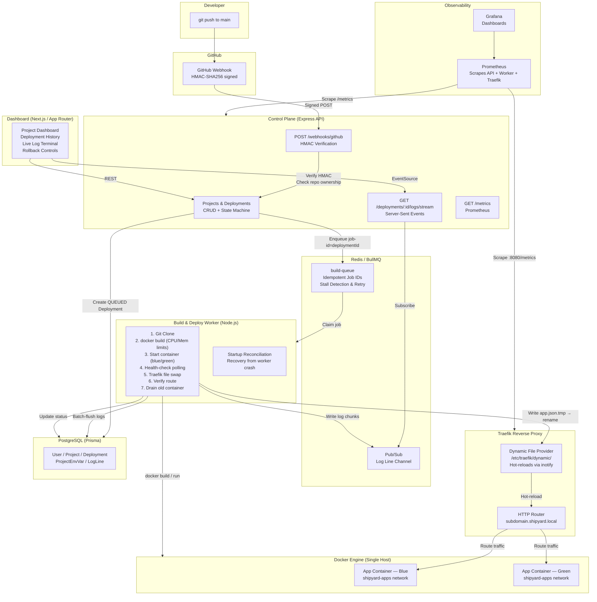
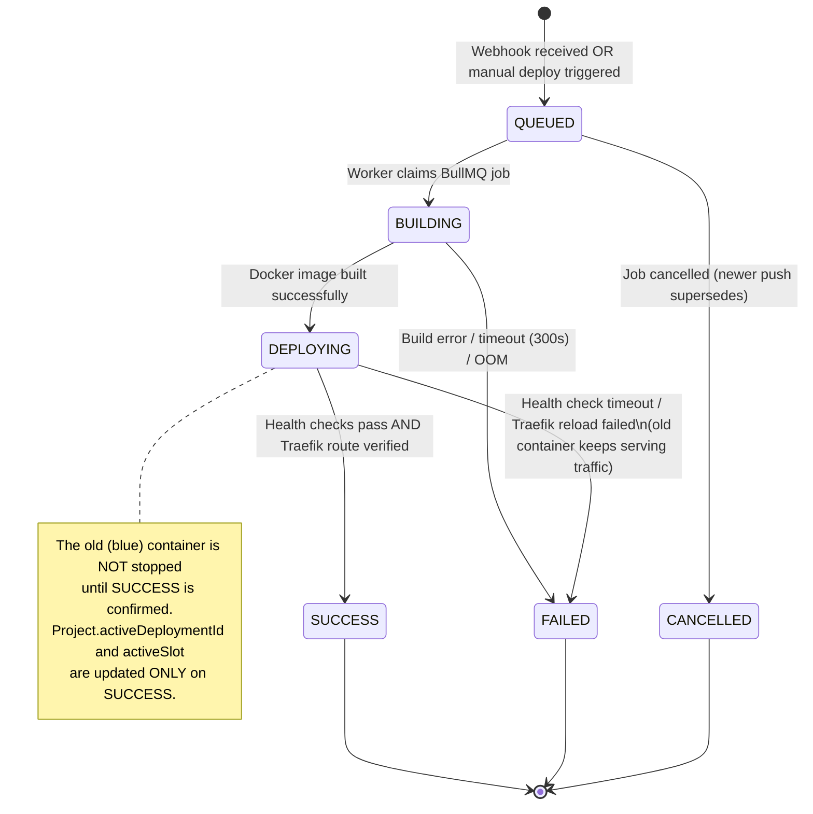

# Shipyard 🚢

> A self-hosted mini deployment platform — a simplified Heroku/Vercel built from first principles as a portfolio project for full-stack, cloud, and DevOps engineering roles.

[](./docs/DECISIONS.md)
[](https://www.typescriptlang.org/)
[](https://nodejs.org/)
[](./LICENSE)

---

## Table of Contents

1. [What Shipyard Does](#what-shipyard-does)
2. [Architecture](#architecture)
3. [Repository Structure](#repository-structure)
4. [Deployment State Machine](#deployment-state-machine)
5. [Security Boundary](#security-boundary)
6. [Local Development Setup](#local-development-setup)
7. [Infrastructure Services](#infrastructure-services)
8. [Blue-Green Deployment & Traefik Routing](#blue-green-deployment--traefik-routing)
9. [Design Decisions and Trade-offs](#design-decisions-and-trade-offs)
10. [Implementation Phases](#implementation-phases)
11. [Known Limitations](#known-limitations)

---

## What Shipyard Does

A user logs in with GitHub, registers one of their own repositories (which contains a `Dockerfile`), and every push to `main` automatically:

1. **Builds** a Docker image in a sandboxed, resource-limited environment.
2. **Streams** live build and deploy logs to the dashboard via Server-Sent Events.
3. **Deploys** the new container alongside the old one (blue-green) and waits for health checks.
4. **Switches** traffic atomically via Traefik dynamic configuration.
5. **Rolls back** automatically if health checks fail; the old version never drops a request.

### Out of Scope
Multi-region, billing, framework auto-detection, custom domains, multi-host clusters, and support for repositories without a `Dockerfile`.

---

## Architecture



---

## Repository Structure

```
Shipyard/
├── apps/
│   ├── api/           # Express control plane (Phase 2)
│   ├── worker/        # Build & deploy pipeline (Phases 3-4)
│   └── dashboard/     # Next.js dashboard (Phase 5)
├── packages/
│   └── shared/        # Shared TypeScript types & Zod schemas (Phase 1)
├── monitoring/
│   ├── prometheus/    # Prometheus scrape configuration
│   └── grafana/       # Grafana datasource and dashboard provisioning
├── terraform/         # AWS IaC (Phase 7 — plan/validate only until approved)
├── test-fixtures/     # Minimal Dockerfile app for integration tests
├── docs/
│   ├── DECISIONS.md   # Architecture Decision Records (ADRs)
│   ├── ARCHITECTURE.md
│   └── INTERVIEW_GUIDE.md
├── docker-compose.infra.yml  # Backing services for local dev
├── .env.example              # Secret template — NEVER commit .env
├── Makefile                  # Developer shortcuts
├── package.json              # npm workspaces root
└── tsconfig.base.json        # Shared TypeScript configuration
```

---

## Deployment State Machine

Deployment lifecycle status (`Deployment.status`) is **strictly separated** from which deployment is actively serving traffic (`Project.activeDeploymentId`).



### Rollback Creates a New Deployment Record
Manual rollback does **not** modify the status of any existing deployment. Instead:
1. A **new** `Deployment` record is created with `imageTag` pointing to the target's immutable image.
2. The new record progresses through `QUEUED → DEPLOYING → SUCCESS` (no build step — image already exists).
3. Only after the rollback target passes health checks does `Project.activeDeploymentId` update.

This preserves the complete, auditable deployment history.

---

## Security Boundary

> **Shipyard is a single-owner platform.** It is designed to deploy repositories owned by the platform operator. Running untrusted third-party code is explicitly out of scope.

### Network Isolation

| Network | Services Attached | Purpose |
|---|---|---|
| `shipyard-infra` | PostgreSQL, Redis, API, Worker, Prometheus, Grafana | Platform internals — isolated from user apps |
| `shipyard-apps` | Traefik, Application Containers | User-facing traffic routing only |

**Application containers cannot reach PostgreSQL or Redis.** They are only on `shipyard-apps`.

### Secret Isolation
- Platform secrets (`DATABASE_URL`, `REDIS_URL`, `GITHUB_WEBHOOK_SECRET`) are only injected into the API and Worker.
- When the Worker starts a user application container, it injects **only** the project's own environment variables from `ProjectEnvVar` — never platform credentials.
- Application containers are **never** given access to `/var/run/docker.sock`.

### Container Hardening
- `--memory=1024m --memory-swap=1024m` — hard memory cap, no unlimited swap
- `--cpus=1.0` — CPU quota
- `--security-opt=no-new-privileges` — prevents privilege escalation inside container
- Build timeout: 300 seconds (killed with SIGKILL if exceeded)

---

## Local Development Setup

### Prerequisites
- [Docker Desktop](https://www.docker.com/products/docker-desktop/) (or Docker Engine + Compose plugin)
- Node.js ≥ 20 (`node --version`)
- npm ≥ 10 (`npm --version`)

### 1. Clone and configure

```bash
git clone https://github.com/you/shipyard.git
cd shipyard

# Create your local .env from the template
cp .env.example .env

# Edit .env — at minimum set POSTGRES_PASSWORD and a random GITHUB_WEBHOOK_SECRET
# openssl rand -hex 32   ← use this to generate secrets
```

### 2. Start backing infrastructure

```bash
make infra-up

# Wait for all services to become healthy
make wait-infra
```

### 3. Verify all services are healthy

```bash
make verify-infra
```

Expected output:
```
✅  Postgres healthy
✅  Redis healthy
✅  Traefik healthy
All infrastructure services are healthy.
```

### 4. Install npm dependencies

```bash
make install
```

### 5. Run TypeScript type-check

```bash
make typecheck
```

### 6. Local DNS for wildcard subdomains (macOS)

Traefik routes traffic to `<appname>.shipyard.local`. To resolve this in your browser:

```bash
# Option A: Single entry in /etc/hosts
echo "127.0.0.1  shipyard.local" | sudo tee -a /etc/hosts

# Option B: Wildcard (recommended) using dnsmasq
brew install dnsmasq
echo 'address=/.shipyard.local/127.0.0.1' | tee -a $(brew --prefix)/etc/dnsmasq.conf
sudo brew services start dnsmasq

# Verify
make local-dns-check
```

---

## Infrastructure Services

| Service | URL (local) | Purpose |
|---|---|---|
| PostgreSQL | `localhost:5432` | Relational database (connect with `psql` or Prisma Studio) |
| Redis | `localhost:6379` | BullMQ job queue + Pub/Sub log streaming |
| Traefik Dashboard | http://localhost:8080 | Routing rules, service health |
| Prometheus | http://localhost:9090 | Metrics — query with PromQL |
| Grafana | http://localhost:3100 | Dashboards — login: `admin` / `admin` |

---

## Blue-Green Deployment & Traefik Routing

Traefik routes traffic using its **dynamic file provider** — not Docker labels. This is a key design decision (see [ADR-004 in DECISIONS.md](./docs/DECISIONS.md)).

The worker switches traffic by doing an **atomic file rename**:

```
Write routing config → /etc/traefik/dynamic/${projectId}.tmp.yml
fs.rename(tmp, final)   ← POSIX-atomic, Traefik detects via inotify
```

After the rename, the worker **verifies** the switch before marking deployment `SUCCESS`:

```
1. Poll Traefik API /api/http/services → confirm service URL updated
2. Poll app health endpoint via Traefik ingress (not direct container)
3. Both checks must pass within timeout → mark SUCCESS, drain old container
4. If either check times out → mark FAILED, restore config, leave old container live
```

---

## Design Decisions and Trade-offs

See [`docs/DECISIONS.md`](./docs/DECISIONS.md) for complete Architecture Decision Records.

| Decision | Choice | Key Trade-off |
|---|---|---|
| State separation | Deployment lifecycle vs. active routing pointer | Prevents ambiguous superseded-vs-failed states |
| Traefik routing | Dynamic file provider | Atomic cutover vs. more complex than Docker labels |
| Queue | BullMQ (Redis) | Persistent, stall-aware; Redis is already in stack |
| ORM | Prisma | Explicit migrations, good TypeScript types; slightly verbose |
| Testing | Vitest | Fast native TS runner; same API as Jest |
| Secrets | `.env` locally, AWS SSM in prod | Never in code or logs |

---

## Implementation Phases

| Phase | Status | Description |
|---|---|---|
| **Phase 0** | ✅ Complete | Monorepo, TypeScript config, local Docker Compose infra |
| **Phase 1** | ✅ Complete | Domain models (Prisma), deployment state machine, unit tests |
| **Phase 2** | ✅ Complete | Express API, GitHub webhook HMAC verification, BullMQ queue |
| **Phase 3** | ✅ Complete | Build worker, exact commit checkout, CFS quotas, Docker pipeline |
| **Phase 4** | ✅ Complete | Blue-green deployment, health checks, Traefik atomic cutover |
| **Phase 5** | ✅ Complete | SSE log streaming, Next.js dashboard |
| **Phase 6** | ✅ Complete | Prometheus instrumentation, Grafana dashboards |
| **Phase 7** | ✅ Complete | Terraform IaC for AWS (EC2, VPC, IAM/SSM, ECR, validate/plan verified) |

---

## AWS Cloud Infrastructure (Phase 7 — Terraform)

Shipyard includes production-ready Infrastructure as Code (IaC) in `terraform/` to deploy the single-host architecture to AWS while preserving the strict security boundaries defined in [ADR-003](./docs/DECISIONS.md) and [ADR-010](./docs/DECISIONS.md).

### Cloud Architecture Highlights
- **VPC & Subnets:** Isolated VPC (`10.0.0.0/16`) with an Internet Gateway and public subnet (`10.0.1.0/24`).
- **Security Boundary:** Only ports 80 (HTTP) and 443 (HTTPS) are exposed to the internet. Database, cache, metrics, and internal API ports bind strictly to `127.0.0.1` and are blocked at the AWS Security Group firewall.
- **Keyless Management (SSM):** Attached `AmazonSSMManagedInstanceCore` IAM policy allows secure, audited shell access via AWS Systems Manager Session Manager (`aws ssm start-session`) without managing SSH keys.
- **Automated Host Bootstrap:** `user_data.sh` provisions Docker Engine CE with log rotation limits (`max-size: 10m`), Node.js 20 LTS, and system users.
- **Static Public IP:** Dedicated AWS Elastic IP ensures domain DNS records remain stable.
- **Private Container Registry:** Optional Amazon ECR repository with automated image vulnerability scanning.

### Terraform Commands

```bash
# Validate Terraform syntax and configuration
make tf-validate

# Generate offline execution plan (verifies all 17 resources without deploying)
make tf-plan

# Format Terraform HCL files
make tf-fmt
```

---

## Known Limitations

- **Single-host only:** All containers run on one machine. There is no container orchestration or horizontal scaling. This is intentional scope — the architecture explicitly documents where Kubernetes or ECS would replace this single-host setup.
- **Owner's repositories only:** Shipyard is not a multi-tenant public platform. Running repositories owned by others is not supported and is explicitly out of scope. See [ADR-003](./docs/DECISIONS.md).
- **No TLS in local dev:** Traefik listens on HTTP port 80 locally. In production (Phase 7), Traefik handles TLS termination via Let's Encrypt.
- **No framework auto-detection:** Every deployed repository must contain a `Dockerfile`. Buildpacks or Nixpacks are out of scope.
